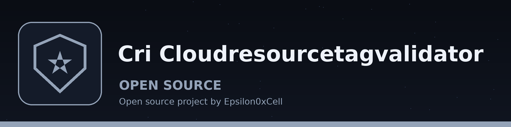

# CRI-CloudResourceTagValidator
Validates cloud resource tags against predefined policies (e.g., naming conventions, mandatory tags). Uses boto3 to scan resources and reports violations in a user-friendly format. - Focused on Checks AWS EC2 instance tags against mandatory tag and naming policies and reports the instances that do not meet them. Only AWS EC2 is supported: there is no Azure or GCP support, and the tool does not inspect settings, ports, or IAM roles.

## Install
`git clone https://github.com/ShadowGuardAI/cri-cloudresourcetagvalidator`

## Usage
`./cri-cloudresourcetagvalidator [params]`

## Parameters
- `-h`: Show help message and exit

## License
Copyright (c) ShadowGuardAI
